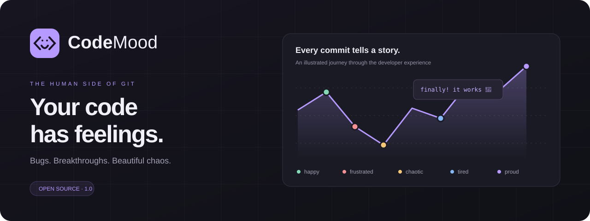

<div align="center">



**Seu histórico de commits tem mais do que código. Tem uma história.**

Uma timeline das pequenas vitórias, dos dias difíceis e da energia de “na minha máquina funciona”.


[Experiência](#a-experiência) · [Humores](#seis-humores-muitas-histórias) · [Começar](#rodando-localmente) · [Arquitetura](docs/ARCHITECTURE.md) · [Contribuir](CONTRIBUTING.md)

</div>

---

## O lado humano do Git

Você lembra do que entregou. Mas lembra de como foi chegar lá?

CodeMood transforma mensagens de commits em uma retrospectiva visual. Ele reconhece expressões em português e inglês, agrupa o tom das mensagens ao longo das semanas e destaca aqueles commits que contam uma história por conta própria.

> `fix: bug handler` → neutro  
> `finally! it works 🎉` → feliz  
> `temp hack, fix it later` → caótico

**É uma interpretação da linguagem, não um diagnóstico emocional.** Ironia, contexto e estilos de escrita podem mudar completamente o sentido de uma mensagem. Use os resultados para conversar e refletir, não para avaliar a saúde ou o desempenho de pessoas.

## A experiência

| Recurso                      | O que você encontra                                                                                           |
| ---------------------------- | ------------------------------------------------------------------------------------------------------------- |
| **Importação do GitHub**     | Cole uma URL ou `owner/repo`; escolha uma branch opcional. Até 500 commits recentes de repositórios públicos. |
| **Timeline emocional**       | Gráfico interativo com média semanal ou mensal, datas em UTC e tooltip por período.                           |
| **Distribuição de humores**  | Seis categorias, contagens e porcentagens calculadas sobre o mesmo recorte.                                   |
| **Filtros combinados**       | Projeto, data inicial/final, autor e humor; busca por mensagem, autor ou SHA no diário.                       |
| **Retrospectiva explicável** | Abra um commit para ver a mensagem completa e as expressões que determinaram a classificação.                 |
| **Comparação de projetos**   | Gráficos e distribuições lado a lado; até oito projetos salvos neste navegador.                               |
| **Destaques automáticos**    | As mensagens de maior intensidade textual, com contexto e motivo da classificação.                            |
| **Commit do mês**            | Escolha o mês e descubra o destaque entre os commits do recorte.                                              |
| **Cartões compartilháveis**  | Baixe a timeline ou um commit em PNG de 1200 × 630. Nada é publicado automaticamente.                         |
| **Exportação JSON**          | Leve os commits filtrados e suas classificações para outras análises.                                         |
| **Dark / light**             | Tema escuro “developer insomnia” e modo claro, com preferência persistida.                                    |
| **Demo pronta**              | Dois repositórios fictícios para explorar sem conta, token ou configuração.                                   |
| **OAuth opcional**           | Conexão com GitHub via state + PKCE e cookie cifrado, após configurar as credenciais.                         |

## Seis humores, muitas histórias

| Humor           | Exemplo                           | Pontuação da timeline |
| --------------- | --------------------------------- | :-------------------: |
| ✦ **Feliz**     | `finalmente funcionou!`           |         +100          |
| ★ **Orgulhoso** | `shipped! proud of this release`  |         +100          |
| − **Neutro**    | `docs: update installation guide` |           0           |
| ! **Frustrado** | `ugh, broken again`               |         −100          |
| ↯ **Caótico**   | `wip: fix it later`               |           0           |
| ☾ **Cansado**   | `need coffee and sleep`           |          −70          |

A timeline mostra a **média** dessas pontuações por período. Caos aparece separado na distribuição, mesmo compartilhando o valor zero com mensagens neutras. Semanas sem commits não recebem valores inventados; a linha conecta os períodos com dados.

O mecanismo usa expressões explícitas, pesos e negação simples. Termos técnicos como `fix` e `bug` sozinhos não viram frustração. Não há LLM, cobrança por análise ou envio de mensagens a um serviço de IA. [Conheça as regras e limitações →](docs/ARCHITECTURE.md#critérios-de-análise)

## Uma retrospectiva em quatro passos

1. **Explore a demonstração** para conhecer os gráficos e os destaques.
2. **Adicione um repositório público**, com a branch desejada.
3. **Escolha o recorte** e, para uma jornada individual, filtre pelo autor.
4. **Abra os commits e exporte um cartão** para sua retrospectiva ou README.

A primeira importação real substitui a demonstração. Projetos importados permanecem no navegador. Reimportar um projeto atualiza sua amostra e sua branch. O aviso de amostra parcial aparece quando existem mais de 500 commits.

## Rodando localmente

**Requisitos:** Node.js 20.9+ e npm. A integração contínua utiliza Node.js 22.

```sh
npm ci
npm run dev
```

Abra **http://localhost:3000**. A demo e a importação pública funcionam sem `.env`.

| Comando             | Finalidade                                          |
| ------------------- | --------------------------------------------------- |
| `npm run dev`       | Ambiente de desenvolvimento                         |
| `npm test`          | Testes da análise, agregação, GitHub e criptografia |
| `npm run typecheck` | Verificação TypeScript                              |
| `npm run build`     | Build de produção                                   |
| `npm start`         | Servidor de produção após o build                   |

### Conexão opcional com GitHub

O botão de login é ativado com `APP_URL`, `GITHUB_CLIENT_ID`, `GITHUB_CLIENT_SECRET` e `SESSION_SECRET`. O arquivo `.env.example` documenta essas variáveis; o guia de [configuração](docs/CONFIGURATION.md) detalha OAuth e execução em produção.

O escopo é `read:user`. Esta versão analisa **somente repositórios públicos**. A conexão permite usar a cota autenticada da API, sujeita aos limites do GitHub. Nenhum token fica em localStorage ou é enviado ao JavaScript do cliente.

## Feito com

| Camada       | Tecnologia                                     |
| ------------ | ---------------------------------------------- |
| Aplicação    | Next.js 16 · React 19 · TypeScript             |
| Interface    | Tailwind CSS 4 · estilos próprios · Lucide     |
| Visualização | Recharts 3                                     |
| Dados        | GitHub REST API, consultada pelo servidor      |
| Análise      | Regras locais PT/EN, sem chave de IA           |
| Sessão       | OAuth GitHub · PKCE · AES-256-GCM              |
| Persistência | localStorage, sem banco obrigatório            |
| Exportação   | Canvas PNG e JSON                              |
| Qualidade    | Node test runner · TypeScript · GitHub Actions |

Compatível com ambientes Node.js e Vercel. As rotas de API precisam de servidor: este projeto não é uma exportação HTML estática.

## Privacidade e limites

- Mensagens são consultadas no GitHub e analisadas localmente. O aplicativo não cria um banco central de commits.
- Filtros de data e autor atuam sobre a amostra importada, não sobre todo o histórico remoto.
- Projetos com vários autores representam um conjunto de mensagens. O nome “seu humor” não significa que todos os commits sejam seus.
- A classificação é heurística: sarcasmo, negações complexas, idiomas e mensagens sem contexto podem gerar erros.
- Os dados locais podem ser apagados em **Como funciona**. Sair da conta encerra a sessão separadamente.
- Revise mensagens e nomes de autores antes de compartilhar um cartão.

## Próximos capítulos

A versão 1.0 entrega a experiência principal. Evoluções planejadas, **ainda não implementadas**:

- [ ] Importação incremental de históricos maiores e seleção múltipla de branches.
- [ ] Dicionários comunitários, mais idiomas e análise contextual opcional.
- [ ] Mais formatos de cartão e templates para README.
- [ ] Perfil público com compartilhamento explícito.
- [ ] Resumo semanal por e-mail com consentimento.
- [ ] Acesso privado via GitHub App com permissões granulares.

## Contribuições

Uma expressão que só faz sentido no seu idioma? Um caso de ironia que merece um teste? Uma melhoria de acessibilidade?

Leia o [guia de contribuição](CONTRIBUTING.md). A ideia é construir retrospectivas mais honestas, divertidas e respeitosas.

**Licença MIT** · [allyxzs](https://github.com/allyxzs)

---

<div align="center">

**Você é mais que seu código.**  
Até os melhores projetos têm dias de “depois eu arrumo”.

</div>
